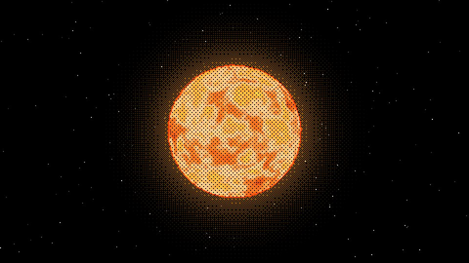
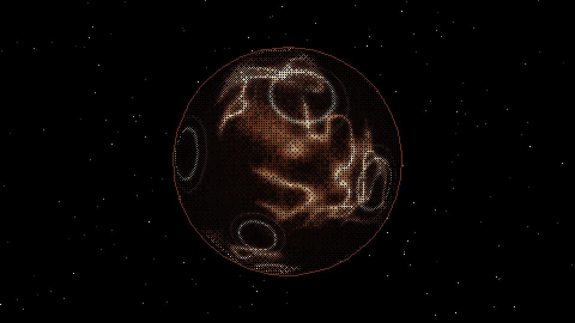
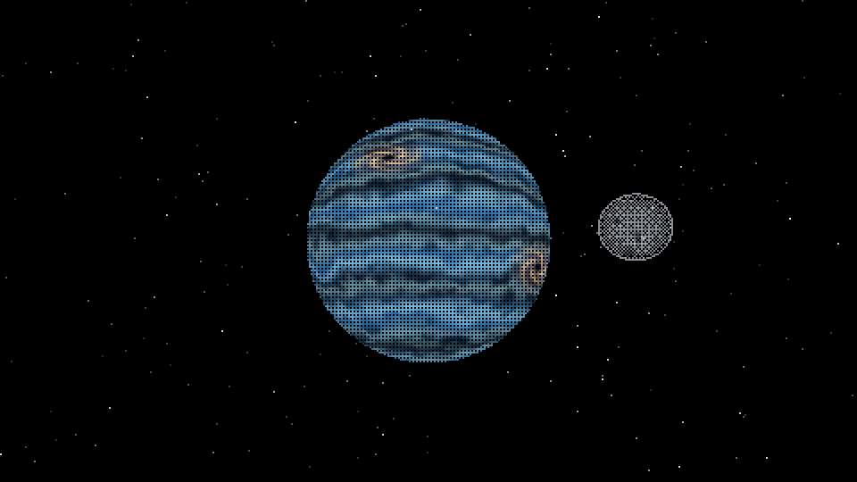
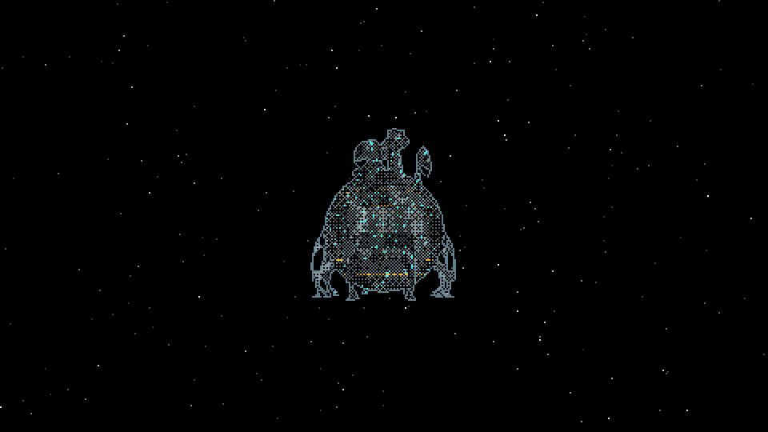
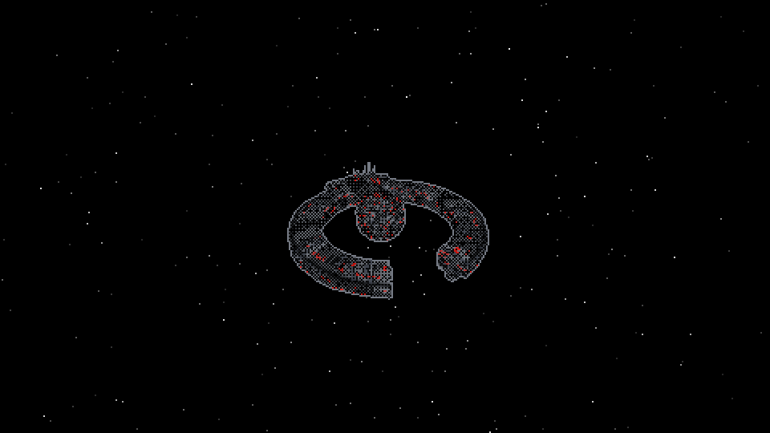

# Laboratorio 5: Shaders de planetas

Visualizador de cuerpos celestes desarrollado en Rust sobre un **software renderer**. Todos los colores, relieves visuales y patrones se calculan proceduralmente mediante shaders: el proyecto no utiliza texturas, imágenes de superficie ni mapas de materiales.

Exportado desde mi trabajo en el proyecto: [Proyecto 3](https://github.com/bianckaa/gc-proyecto-3/tree/feature/carga-modelos-planetas)

El laboratorio incluye los tres cuerpos requeridos —Sol, planeta rocoso y gigante gaseoso—, dos diseños adicionales —CORE y Droid— y una luna independiente que orbita el gigante gaseoso.

## Ejecución

Se requiere Rust y Cargo. Desde la raíz del repositorio:

```bash
cargo run
```

El visualizador también permite abrir directamente un cuerpo:

```bash
cargo run -- --planet sun
cargo run -- --planet rocky
cargo run -- --planet gas
cargo run -- --planet core
cargo run -- --planet droid
```

Los nombres en español `sol`, `rocoso` y `gaseoso` también son válidos.

## Controles

| Control | Acción |
|---|---|
| `1` | Mostrar el Sol |
| `2` | Mostrar el planeta artificial CORE |
| `3` | Mostrar el planeta rocoso |
| `4` | Mostrar el gigante gaseoso y su luna |
| `5` | Mostrar el planeta mecánico Droid |
| Arrastrar con clic izquierdo | Orbitar la cámara |
| Rueda del mouse | Acercar o alejar la cámara |
| `R` | Restablecer la cámara |
| `Espacio` | Pausar o reanudar la rotación |
| `B` | Activar o desactivar dithering |
| `O` | Activar o desactivar contornos |
| `H` | Activar o desactivar la distorsión térmica del Sol |

## Shaders y capas de color

Cada shader principal posee al menos cuatro capas que afectan el color final.

| Cuerpo | Capas principales |
|---|---|
| Sol | Flujo de plasma, gránulos, filamentos brillantes y erupciones animadas |
| Planeta rocoso | Valles, cordilleras, cumbres minerales, cráteres, erosión, oclusión y relieve |
| Gigante gaseoso | Bandas anchas, corrientes finas, remolinos, huracanes y mezcla atmosférica |
| CORE | Placas, bloques superpuestos, circuitos, módulos y canales de energía |
| Droid | Blindaje, zanjas, franjas industriales, respiraderos y conductos rojos |
| Luna | Regolito, mares basálticos, cuencas de impacto y bordes con rayos de eyección |

La iluminación, el ruido, el dithering y los efectos animados se calculan por fragmento dentro del renderer. Los archivos OBJ aportan únicamente la geometría.

## Modelos independientes

- `Planet.obj`: geometría utilizada por el Sol, el planeta rocoso y el gigante gaseoso.
- `CORE_.obj`: geometría del planeta artificial CORE.
- `Droid_confed.obj`: geometría del planeta mecánico Droid.
- `moon.obj`: modelo separado para la luna. Se renderiza como otro objeto, con escala, transformación, órbita y shader propios.

La luna rota y se traslada alrededor del gigante gaseoso en tiempo real, cumpliendo la recomendación de no integrarla en la misma malla del planeta.

## Screenshots

### Sol



### Planeta rocoso



### Gigante gaseoso con luna



### Planeta artificial CORE



### Planeta mecánico Droid



## Generación de capturas

El programa puede guardar una captura automáticamente después de estabilizar la animación:

```bash
cargo run -- --planet gas --capture screenshots/gas_moon.png
```

Para comparar el resultado sin dithering:

```bash
cargo run -- --planet gas --no-dither --capture screenshots/gas_no_dither.png
```

## Alcance del laboratorio

- Tres cuerpos requeridos renderizados exclusivamente con shaders.
- Cinco diseños principales seleccionables.
- Cuatro o más capas de color en todos los shaders presentados.
- Cámara orbital, zoom y rotación animada.
- Dithering, contornos y fondo estelar generados por el renderer.
- Luna independiente con shader procedural y movimiento orbital.
- Sin texturas ni mapas de materiales.
